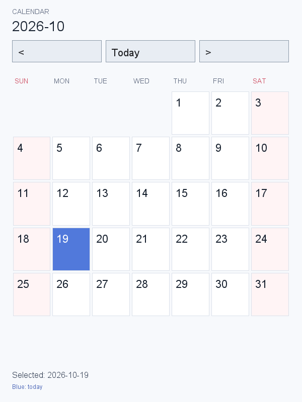
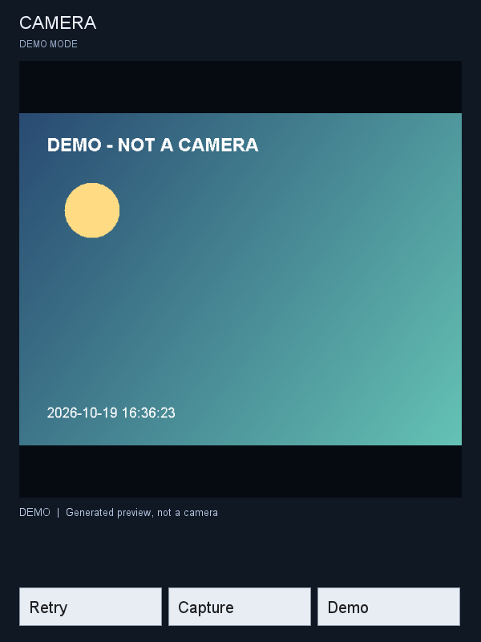
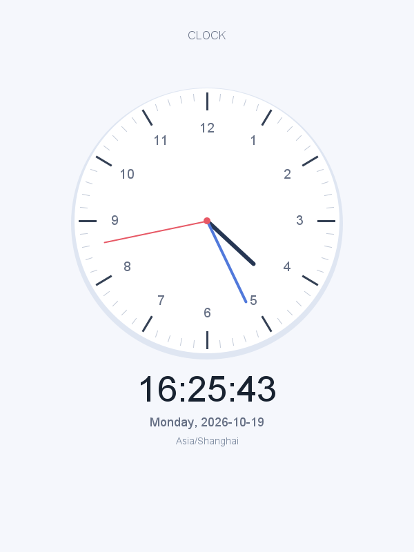

What I cannot create, I do not understand. -费曼

我无法创造的，我就不理解。创造就是探索本质的过程。
# framework
开发环境：ubuntu20.04 

JAVA 版本： OpenJDK 1.8

开发工具: IJ

这个项目接  github.com/MrXiangVip/Android 这个项目。

开发工具换到 IJ  ， 用IJ 写Java 的代码还是要流畅很多。

下面这个博客解释了代码流程。

https://blog.csdn.net/blueheart05/article/details/135069627?spm=1001.2014.3001.5502


运行方法：
执行 build.sh 
xshx@xshx:~/IdeaProjects/framework$ ./build.sh


点击日历



点击相机



点击时钟



都能分别进入应用

Browser: [build and usage](packages/apps/browser/README.md)


窗口大小：应用可以通过 `WindowManager.LayoutParams` 提交客户端尺寸（像素）：

```java
WindowManager wm = activity.getWindow().getWindowManager();
View decor = activity.getWindow().getDecorView();
// 已添加的窗口使用 updateViewLayout；新窗口使用 addView(view, params)。
WindowManager.LayoutParams params = new WindowManager.LayoutParams(
        640, WindowManager.LayoutParams.WRAP_CONTENT);
wm.updateViewLayout(decor, params);
```

`WindowManagerService.computeWindowSize()` 统一计算尺寸：非负值指定像素大小，
`MATCH_PARENT` 填满显示区域，`WRAP_CONTENT` 在显示区域限制下测量内容。
尺寸限制在 1 像素到显示区域大小之间；小于 `WRAP_CONTENT`（-2）的值非法。
`ViewRootImpl` 将计算结果用于创建或调整 X11 窗口，然后按实际窗口尺寸布局绘制。
内容调用 `requestLayout()` 时会重新计算，外部窗口缩放事件则按桌面返回的尺寸布局。
当前显示区域使用整个 X11 默认屏幕，尚未扣除桌面面板或实现 Android Insets；
本次尺寸计算不处理 `x/y`、gravity 或窗口类型策略。

尺寸规则测试（先编译 framework，将 FRAMEWORK_CLASSES 指向编译输出）：

```bash
javac -cp "$FRAMEWORK_CLASSES" -d /tmp/window-tests tests/com/android/wm/WindowSizeTest.java
java -cp "$FRAMEWORK_CLASSES:/tmp/window-tests" com.android.wm.WindowSizeTest
```
