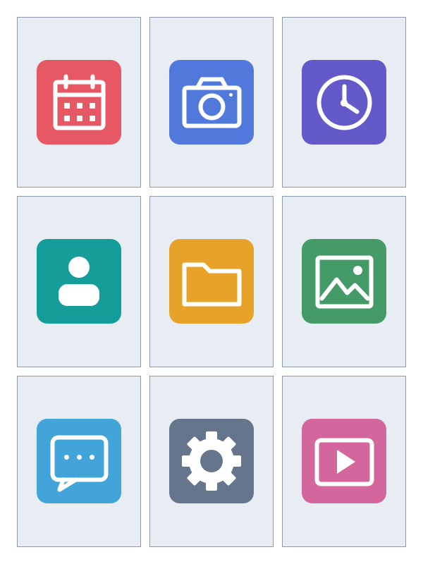
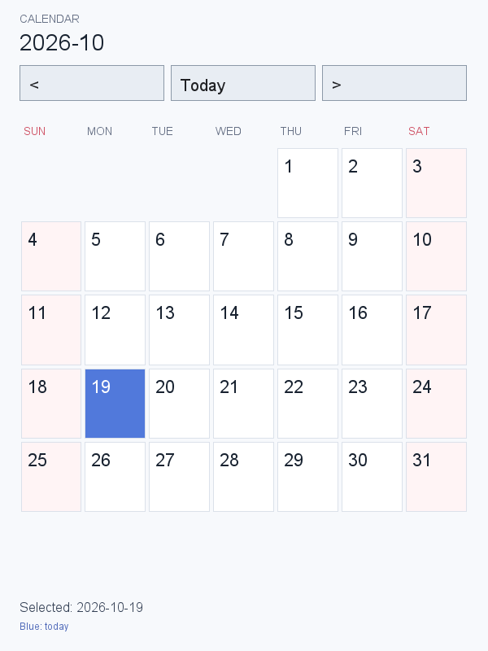
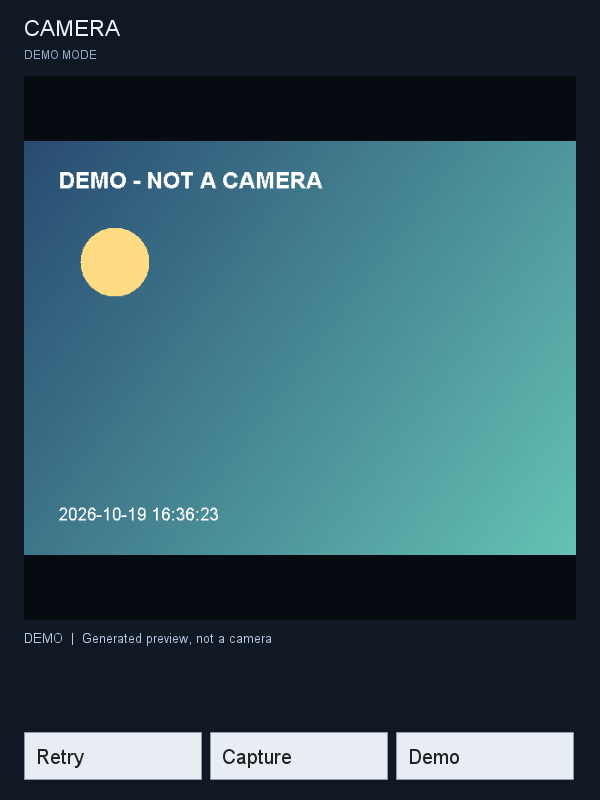
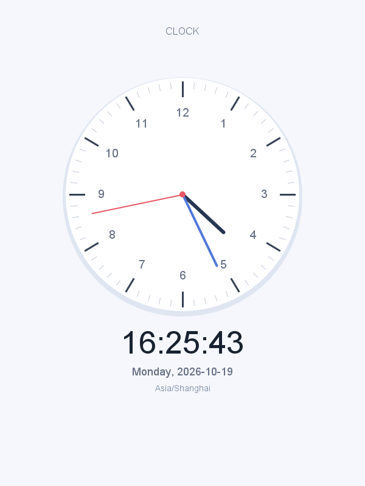
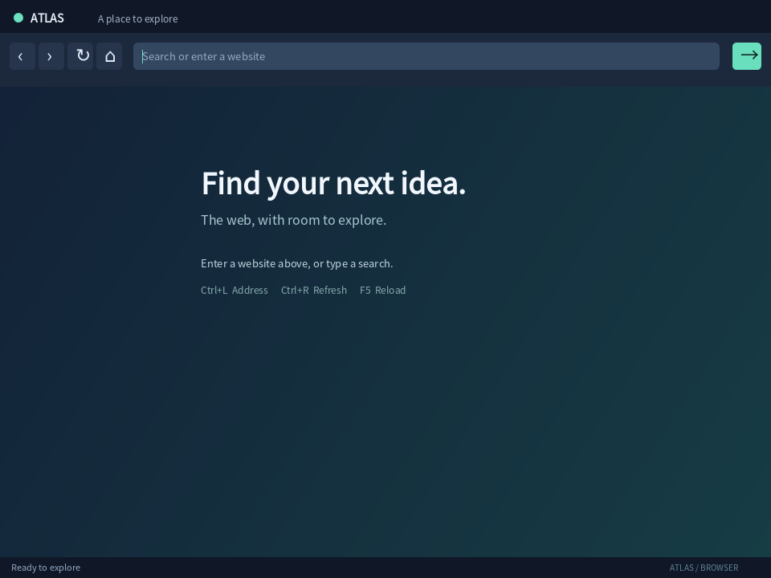

What I cannot create, I do not understand. -费曼

我无法创造的，我就不理解。创造就是探索本质的过程。
# framework
开发环境：ubuntu20.04 

JAVA 版本： OpenJDK 1.8

开发工具: IJ

这个项目接  github.com/MrXiangVip/Android 这个项目。

开发工具换到 IJ  ， 用IJ 写Java 的代码还是要流畅很多。

下面这个博客解释了代码流程。

https://blog.csdn.net/blueheart05/article/details/135069627?spm=1001.2014.3001.5502


运行方法：
执行 build.sh 
xshx@xshx:~/IdeaProjects/framework$ ./build.sh




点击日历



点击相机



点击时钟



都能分别进入应用

Browser: [build and usage](packages/apps/browser/README.md)

星隙竞技场：[基于当前 Java / OpenGL 框架的 3D 三路 MOBA 与运行方法](packages/apps/rift-arena/README.md)。从 Launcher 直接进入游戏，无需 Unity。
由 Launcher 启动独立 Linux Unity Player；需要先安装 Unity 编辑器并导出游戏。



窗口大小：应用可以通过 `WindowManager.LayoutParams` 提交客户端尺寸（像素）：

```java
WindowManager wm = activity.getWindow().getWindowManager();
View decor = activity.getWindow().getDecorView();
// 已添加的窗口使用 updateViewLayout；新窗口使用 addView(view, params)。
WindowManager.LayoutParams params = new WindowManager.LayoutParams(
        640, WindowManager.LayoutParams.WRAP_CONTENT);
wm.updateViewLayout(decor, params);
```

`WindowManagerService.computeWindowSize()` 统一计算尺寸：非负值指定像素大小，
`MATCH_PARENT` 填满显示区域，`WRAP_CONTENT` 在显示区域限制下测量内容。
尺寸限制在 1 像素到显示区域大小之间；小于 `WRAP_CONTENT`（-2）的值非法。
`ViewRootImpl` 将计算结果用于创建或调整 X11 窗口，然后按实际窗口尺寸布局绘制。
内容调用 `requestLayout()` 时会重新计算，外部窗口缩放事件则按桌面返回的尺寸布局。
当前显示区域使用整个 X11 默认屏幕，尚未扣除桌面面板或实现 Android Insets；
本次尺寸计算不处理 `x/y`、gravity 或窗口类型策略。

尺寸规则测试（先编译 framework，将 FRAMEWORK_CLASSES 指向编译输出）：

```bash
javac -cp "$FRAMEWORK_CLASSES" -d /tmp/window-tests tests/com/android/wm/WindowSizeTest.java
java -cp "$FRAMEWORK_CLASSES:/tmp/window-tests" com.android.wm.WindowSizeTest
```

游戏原始 Unity 资源包和完整导出库统一放在根目录 `external/`，目录约定、导入命令与现有素材清单见 [external/README.md](external/README.md)。

应用布局资源 ID：应用构建时会自动扫描 `res/layout/*.xml`，在构建临时目录生成
应用包名下的 `R.java`，并将 `META-INF/framework/resources.properties` 索引打包进 APK。
应用可以使用 `setContentView(R.layout.activity_main)`，或
`LayoutInflater.from(context).inflate(R.layout.activity_main, parent, false)`；
原有字符串路径接口继续可用。日历应用已采用整数 ID。

完整实现过程、运行时链路及 Android 原生机制对比见
[自研资源管理框架](doc/RESOURCE_MANAGEMENT.md)。

运行时每个应用的 `Resources` 使用其 ClassLoader 读取索引和布局，
`getLayout(id)` 返回布局 XML 解析器，未知 ID 抛出 `Resources.NotFoundException`。
当前支持默认 `layout`、`id`、位图 `drawable` 和 `string` 类型，不支持配置限定符
或 Android 二进制 ARSC。布局文件名必须是合法 Java 标识符且不能是关键字。
ID 按文件名排序分配，同一输入可重复生成；增加或删除文件可能改变 ID，
因此不要将整数资源 ID 持久化到数据库或跨版本传递。

布局中的 `android:id="@+id/title"` 会生成 `R.id.title`；`@id/title` 引用同一应用
任一默认布局中声明的 ID，未声明的引用在构建时会报错。同名声明会合并，ID 按名称排序分配。
加载布局后，可用 `findViewById(R.id.title)` 查找控件；找不到时返回 `null`。
`View.setId(int)` 支持动态设置整数 ID，`View.NO_ID` 表示无 ID。
为兼容原接口，`View.getId()` 仍返回字符串，整数 ID 使用 `getResourceId()` 获取；
字符串 `findViewById("title")` 和 `setId("title")` 继续可用。

`res/drawable/` 直属的 PNG、JPG/JPEG、GIF 和 BMP 文件会生成 `R.drawable.文件名`，
例如 `icon.png` 对应 `R.drawable.icon`。同名不同扩展名会导致构建报错。
支持 `imageView.setImageResource(R.drawable.icon)` 和 XML `android:src="@drawable/icon"`；
`setImageResource(0)` 清空图片，错误类型、未知 ID、缺失或损坏图片抛出
`Resources.NotFoundException`。`Resources.getDrawable(id)` 返回当前渲染器使用的
`BufferedImage`，`getDrawablePath(id)` 返回 APK 内路径。
原字符串路径、子目录图片及 `@mipmap/...` 加载方式保持可用，但子目录图片不生成整数 ID。
当前不支持 XML Drawable、矢量图、九宫格、动画或图片密度适配（GIF 仅解码静态帧）。

`res/values/*.xml` 中的 `<resources><string name="greeting">你好</string></resources>`
会生成 `R.string.greeting`（`string` 为小写）。支持 `getString(R.string.greeting)`、
`getString(R.string.message, args...)`、`textView.setText(R.string.greeting)` 和
XML `android:text="@string/greeting"`。格式化使用 Java `String.format` 和默认 Locale，
例如 `%1$s`、`%2$d`。字符串按 UTF-8 编码写入资源索引，支持中文、空字符串、XML 实体、
常见反斜杠转义及 `\uXXXX`，保留 XML 文本中的空白（不实现 Android 的引号和空白折叠规则）。
重复名称、非法名称、未声明的布局字符串引用会导致构建失败；未知或错误类型 ID 在运行时抛出
`Resources.NotFoundException`。当前不支持字符串别名、富文本、复数、数组或 `values-zh` 等语言适配。

构建和无窗口资源链路测试：

```bash
bash packages/apps/build.sh calendar settings
python3 tests/resource_pipeline_test.py
```

软件帧时钟：UI 绘制按需合并到固定节拍，默认目标 60Hz，可通过 JVM 属性
`-Dframework.render.hz=60` 设置（1–1000Hz）。这是软件目标，不代表宿主显示器刷新率。
没有绘制请求时不产生连续帧；UI 阻塞后跳过过期节拍，窗口最小化或关闭时取消待执行遍历。

启用计量：

```bash
JAVA_TOOL_OPTIONS='-Dframework.render.profile=true -Dframework.render.trace=true -Dframework.render.hz=60' ./build.sh
```

`profile` 在有帧提交时每隔至少五秒输出最近最多 256 帧的调度延迟、遍历
（包括窗口尺寸解析和缓冲分配）、native 提交、请求到提交、预算超期和提交间隔的
P50/P95/P99，以及累计帧数、超期帧数和跳过节拍数。空闲期不主动打印。
`trace` 独立启用逐帧记录：帧 ID、该窗口首次请求时间、计划/实际开始时间、遍历开始、
绘制结束、提交返回及软件截止时间，时间戳采用 `System.nanoTime()` 基准。
同一 UI Looper 的同一调度帧共享 ID；跨进程分析时应同时记录日志来源进程。
截止时间为当前计划节拍加一个周期，仅表示软件预算；X11 提交返回不表示屏幕已呈现。
实际呈现反馈尚未接入。详细 trace 会增加输出开销，适合短时诊断。

Handler 的 `sendMessageAtTime` 现在接收 `System.nanoTime() / 1_000_000L`
基准的绝对毫秒时间，`sendMessageDelayed` 接收相对延时；消息按到期时间稳定排序。

帧时钟与延时队列无窗口测试：

```bash
mkdir -p /tmp/framework-frame-tests
javac -encoding UTF-8 -cp 'libs/*' -d /tmp/framework-frame-tests \
  $(rg --files base/com/android -g '*.java') \
  tests/com/android/view/FrameClockTest.java \
  tests/com/android/os/MessageQueueTimingTest.java \
  tests/com/android/view/WindowCloseLifecycleTest.java
java -cp /tmp/framework-frame-tests com.android.view.FrameClockTest
java -cp /tmp/framework-frame-tests com.android.os.MessageQueueTimingTest
java -Djava.awt.headless=true -cp /tmp/framework-frame-tests com.android.view.WindowCloseLifecycleTest
```
