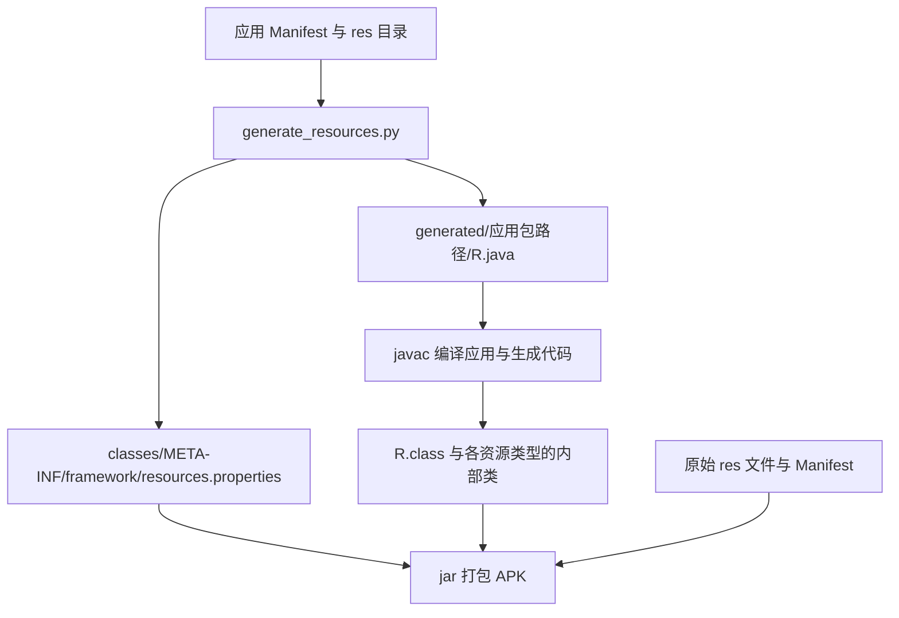

# 自研资源管理框架：实现过程与 Android 原生系统对比

本文记录本项目从字符串路径加载资源，到支持 `R.layout`、`R.id`、`R.drawable` 和 `R.string` 的实现过程。实现状态以当前仓库代码为准，整理日期：2026-11-23。

本框架采用“构建时分配 ID、生成符号与索引，运行时按 ID 查表”的设计。应用获得了接近 Android 的资源调用方式；底层使用 Java ClassLoader、普通 XML、Properties 和 Java AWT，没有实现 Android APK 的完整资源格式。

## 1. 改造前的基础与目标

原有应用主要这样加载布局：

```java
setContentView("res/layout/activity_main.xml");
```

应用构建脚本已经将 `res/` 打包进以 `.apk` 命名的 JAR/ZIP；`LayoutInflater` 已能通过应用 ClassLoader 读取布局 XML 并创建 View。因此本次可以复用打包、类加载和布局解析能力。

当时的不足是：

- 资源路径散落在业务代码中，没有构建时生成的资源符号。
- `Resources` 尚未实现整数 ID 与资源的映射。
- 旧 `XmlBlock` 通过写死的本机绝对路径读取布局，无法承担应用资源定位。
- View ID 以字符串保存，控件通过 `findViewById("title")` 查找。
- 图片和文字缺少统一的整数资源入口。

改造后的业务调用：

```java
setContentView(R.layout.activity_main);
TextView title = (TextView) findViewById(R.id.title);
title.setText(R.string.greeting);
imageView.setImageResource(R.drawable.icon);
```

其中 `R` 只保存整数常量；资源内容位于 APK 中，实际查找和加载由 `Resources` 与相应控件完成。

## 2. 实现过程

| 阶段       | 主要工作                                                  | 得到的能力                              |
|------------|-----------------------------------------------------------|-----------------------------------------|
| 布局资源   | 增加生成器、资源索引、应用级 Resources 和整数布局入口     | `setContentView(R.layout.xxx)`          |
| 控件 ID    | 扫描声明与引用，给 View 绑定整数 ID，增加递归查找         | `findViewById(R.id.xxx)`                |
| 图片资源   | 扫描位图，生成图片索引，接入 ImageIO 和 ImageView         | `setImageResource(R.drawable.xxx)`      |
| 字符串资源 | 扫描 values XML，存储字符串，接入 Context 和 TextView     | `getString(R.string.xxx)`、XML 文本引用 |
| 应用迁移   | 将剩余 12 处布局路径调用改为 ID，迁移 Launcher 的 inflate | 应用的 XML 布局入口统一使用资源 ID      |

日历应用首先用于验证布局 ID 链路。后续迁移覆盖其他使用布局文件的应用。电子书、游戏以及 Launcher 中动态创建的界面仍使用 `setContentView(View)`：这类调用传递的是已经创建的对象，没有对应的布局文件需要定位。

原有字符串路径接口保留，作为兼容入口。

## 3. 代码职责与入口

以下路径均相对仓库根目录。

| 文件                                                                                      | 职责                                                        |
|-------------------------------------------------------------------------------------------|-------------------------------------------------------------|
| [base/tools/generate_resources.py](../base/tools/generate_resources.py)                   | 扫描资源、验证名称和引用、分配 ID、生成 R.java 与资源索引   |
| [packages/apps/build.sh](../packages/apps/build.sh)                                       | 编译前调用生成器，将 R 类、索引和资源打包进 APK             |
| [base/com/android/res/Resources.java](../base/com/android/res/Resources.java)             | 加载应用资源表，提供布局、ID、图片和字符串查询              |
| [base/com/android/app/ContextImpl.java](../base/com/android/app/ContextImpl.java)         | 先绑定应用 ClassLoader，再创建对应的 Resources              |
| [base/com/android/content/Context.java](../base/com/android/content/Context.java)         | 提供 getString 及格式化入口，Activity 通过继承获得这些方法  |
| [base/com/android/app/Activity.java](../base/com/android/app/Activity.java)               | 提供整数 setContentView 和 findViewById                     |
| [base/com/android/view/LayoutInflater.java](../base/com/android/view/LayoutInflater.java) | 将布局 ID 转成路径，复用普通 XML 解析和 View 创建           |
| [base/com/android/view/View.java](../base/com/android/view/View.java)                     | 保存字符串和整数两种控件 ID，完成自身匹配                   |
| [base/com/android/view/ViewGroup.java](../base/com/android/view/ViewGroup.java)           | 递归查找子 View                                             |
| [base/com/android/widget/ImageView.java](../base/com/android/widget/ImageView.java)       | 支持整数图片 ID 和原有路径加载                              |
| [base/com/android/widget/TextView.java](../base/com/android/widget/TextView.java)         | 支持 setText(int) 和 XML 的 @string 引用，Button 继承此能力 |
| [tests/resource_pipeline_test.py](../tests/resource_pipeline_test.py)                     | 构造两个测试 APK，验证构建到运行时的资源链路                |

旧 `XmlBlock` 并未在本次改造中整体重写。新的 `Resources.getLayout()` 直接读取应用布局并创建 XML 解析器，不再调用那个写死路径的实现。

## 4. 构建流程



构建脚本为每个应用创建独立的 `out/apps/应用名.XXXXXX` 临时目录。在这个目录生成源码和索引，再将业务源码与生成源码一起交给 `javac`。

生成代码的包名来自应用 `AndroidManifest.xml` 的 `package`，例如：

```java
package com.packages.calendar;

public final class R {
    // 以下数值仅为结构示例，实际值由该应用的扫描结果决定。
    public static final class layout {
        public static final int activity_main = 0x7f010000;
    }
    public static final class id {
        public static final int title = 0x7f020000;
    }
    public static final class drawable {
        public static final int icon = 0x7f030000;
    }
    public static final class string {
        public static final int greeting = 0x7f040000;
    }
}
```

打包后的结构大致如下：

```text
application.apk
├── AndroidManifest.xml
├── com/packages/example/MainActivity.class
├── com/packages/example/R.class
├── com/packages/example/R$layout.class
├── com/packages/example/R$id.class
├── com/packages/example/R$drawable.class
├── com/packages/example/R$string.class
├── META-INF/framework/resources.properties
└── res/
    ├── layout/activity_main.xml
    ├── drawable/icon.png
    └── values/strings.xml
```

临时生成源码在构建结束后清理，APK 保留编译后的 R 类。生成器与业务源码同次编译，避免手动维护常量与索引时出现不一致。

## 5. ID 分配和资源索引

### 5.1 ID 的结构

本项目使用形如 `0xPPTTEEEE` 的整数：

| 字段   | 本项目含义                                             |
|--------|--------------------------------------------------------|
| `PP`   | 当前应用资源统一使用 `0x7f`                            |
| `TT`   | 固定类型编号：layout=01、id=02、drawable=03、string=04 |
| `EEEE` | 类型内部的条目编号，从 0 开始                          |

类型编号是本项目的约定，不能据此推断 Android 中 layout 或 string 的具体编号。每种类型最多生成 65536 个条目。

文件型资源按排序后的文件列表分配 ID，控件 ID 和字符串按名称排序分配。同样的输入可以重复生成同样的结果，但增删资源可能使后续条目重新编号。资源 ID 不应作为跨版本数据库主键或持久化业务标识。

### 5.2 Properties 格式

索引位于 APK 的 `META-INF/framework/resources.properties`。例如：

```properties
0x7f010000=res/layout/activity_main.xml
id.title=0x7f020000
0x7f030000=res/drawable/icon.png
0x7f040000=greeting|SGVsbG8=
```

不同类型有不同的载荷：

- 布局和图片：整数 ID 对应 APK 内的相对路径。
- 控件 ID：`id.名称` 对应整数，无独立资源文件。
- 字符串：整数 ID 对应 `名称|Base64(UTF-8文本)`；示例中的文本为 `Hello`。

Base64 用于让换行、中文、反斜杠和 Properties 特殊字符能够无损保存，不是加密。索引文件本身保持 ASCII；运行时解码成 Java 字符串。

### 5.3 应用之间如何隔离

`ContextImpl` 先保存应用 ClassLoader，再执行：

```java
mResources = new Resources(getClassLoader());
```

`Resources` 通过该 ClassLoader 读取索引，建立当前应用的 Map。两个应用即使都分配了 `0x7f010000`，也可以分别找到自己 APK 中的布局。

这依赖应用 ClassLoader 的资源解析范围。本实现没有额外的跨包命名空间或合并多份资源表的机制；若以后将多个应用或资源包放进同一个可见资源搜索范围，需要重新设计索引选择和包管理。

没有索引的旧 APK 或系统上下文可以创建空 Resources，原有字符串路径加载仍然可用。

## 6. 四种资源的运行时实现

### 6.1 R.layout：定位布局文件

```text
Activity.setContentView(R.layout.activity_main)
  → Resources.getLayoutPath(id)
  → Activity.setContentView(String)
  → PhoneWindow.setContentView(String)
  → LayoutInflater.inflate(String, ...)
  → ClassLoader.getResourceAsStream(path)
  → XmlPullParser 解析普通 XML
  → 创建并挂载 View 树
```

`LayoutInflater.inflate(int, ...)` 也使用同一条 ID 到路径的映射。普通 XML 内的属性仍以字符串表示，尚未编译成 Android 二进制 XML 或统一的类型值。

另外，`Resources.getLayout(int)` 会读取 XML 为字符串，关闭底层输入流后，用 `StringReader` 创建解析器。当前 `setContentView(int)` 复用的是路径加载链路，并不经过这个单独的解析器接口。

未知或错误类型的布局 ID 抛出 `Resources.NotFoundException`。索引存在但布局文件缺失时，实际加载接口会按各自逻辑抛出 `IllegalArgumentException` 或 `FileNotFoundException`，当前没有统一所有布局错误的异常类型。

### 6.2 R.id：标识已创建的 View

构建器扫描默认布局 XML 的属性值：

```xml
android:id="@+id/title"
```

`@+id/title` 声明名称；`@id/title` 引用同一应用任一默认布局中声明的名称。生成器先收集所有声明，再检查引用，因此跨布局和先引用后声明均可。同名声明合并成同一个整数 ID。

加载时，View 构造函数调用 `setId(String)`，将 `@+id/title` 或 `@id/title` 规范化为 `title`，再从 Resources 查询整数。

查找过程：

```text
Activity.findViewById(R.id.title)
  → DecorView.findViewById(int)
  → 检查当前 View
  → ViewGroup 递归检查子 View
  → 返回第一个匹配的 View，未找到则返回 null
```

资源索引只帮助名称到整数的转换；查找阶段比较的是 View 对象上的整数，不会重新加载 XML。同一 View 树出现重复 ID 时，返回遍历中先找到的对象。

兼容接口：

| 接口                   | 当前行为                                               |
|------------------------|--------------------------------------------------------|
| `getId()`              | 返回原有字符串 ID，与 Android 原生返回 int 不同        |
| `getResourceId()`      | 返回整数 ID                                            |
| `setId(String)`        | 保存规范化名称，并尽可能解析成整数；未知名称对应 NO_ID |
| `setId(int)`           | 保存整数；若索引中存在对应名称，同时更新字符串 ID      |
| `findViewById(String)` | 保留原有字符串查找                                     |
| `findViewById(int)`    | 新增整数查找                                           |
| `View.NO_ID`           | 值为 -1；按此值查找返回 null                           |

当前只从布局中的声明生成 `R.id`，没有实现 `values/ids.xml` 中的 `<item type="id">` 声明方式。

### 6.3 R.drawable：位图加载

生成器扫描 `res/drawable/` 直属的 PNG、JPG/JPEG、GIF 和 BMP，去掉扩展名生成字段，例如 `icon.png → R.drawable.icon`。同名不同扩展名会构建失败；子目录和 XML 文件不生成图片 ID。

```text
ImageView.setImageResource(R.drawable.icon)
  → Resources.getDrawable(id)
  → 查找 APK 内路径
  → ClassLoader 打开输入流
  → ImageIO.read() 解码为 BufferedImage
  → ImageView 替换图片，请求布局与重绘
```

`setImageResource(0)` 清空图片。未知或错误类型 ID、图片文件缺失、解码失败都会抛出 `Resources.NotFoundException`。当前每次 getDrawable 都重新解码，没有资源级位图缓存。

XML 的 `android:src="@drawable/icon"` 先尝试查询资源索引；没有命中时沿用旧的路径及扩展名查找。原有 APK 路径、子目录图片和 `@mipmap/...` 加载仍可使用，但不因此生成 `R.mipmap` 或子目录图片 ID。

`Resources.getDrawable()` 返回本渲染器使用的 `BufferedImage`；它不是 Android 的 `Drawable` 抽象。GIF 只读取静态帧，不提供动画播放。`android:background="@drawable/..."` 也尚未接入，当前 View 背景处理仍是颜色属性。

### 6.4 R.string：文本和格式化

生成器扫描 `res/values/*.xml` 的 `<string name="...">`，文件不必叫 `strings.xml`：

```xml
<resources>
    <string name="greeting">你好</string>
    <string name="welcome">欢迎，%1$s；你有 %2$d 条消息</string>
</resources>
```

```java
String greeting = getString(R.string.greeting);
String message = getString(R.string.welcome, "张三", 3);
title.setText(R.string.greeting);
```

`Context.getString()` 委托给 Resources；格式化使用 `String.format(Locale.getDefault(), ...)`。资源文本与名称在构建时进入索引，运行时无需再解析 values XML。

`TextView` 及其子类 `Button` 支持：

```xml
android:text="@string/greeting"
```

当前资源引用由具体控件处理，并不是任意 XML 属性都能自动解析 `@string/...`。例如 Manifest 标签或其他自定义控件属性，不能仅凭字符串表已经存在就认为获得了资源引用能力。

支持空字符串、中文、XML 实体、常见反斜杠转义和 `\uXXXX`；保留 XML 解析后的文本空白。未实现 Android 字符串的完整引号、空白折叠和富文本语义。

未知或错误类型字符串 ID 抛出 `Resources.NotFoundException`。名称查询接口 `getStringId()`、`getDrawableId()` 未命中返回 0；控件名称查询 `getId()` 未命中返回 -1。

## 7. 一个可运行的应用资源示例

目录：

```text
res/
├── layout/activity_main.xml
├── drawable/icon.png
└── values/strings.xml
```

`res/values/strings.xml`：

```xml
<resources>
    <string name="greeting">你好，资源框架</string>
</resources>
```

`res/layout/activity_main.xml`：

```xml
<LinearLayout xmlns:android="http://schemas.android.com/apk/res/android"
    android:orientation="vertical"
    android:layout_width="match_parent"
    android:layout_height="match_parent">
    <TextView
        android:id="@+id/title"
        android:text="@string/greeting"
        android:layout_width="wrap_content"
        android:layout_height="wrap_content" />
    <ImageView
        android:id="@+id/icon"
        android:src="@drawable/icon"
        android:layout_width="48dp"
        android:layout_height="48dp" />
</LinearLayout>
```

应用与生成的 R 处于同一包时，可以直接使用；跨包源码需要导入应用包的 R：

```java
@Override protected void onCreate() {
    super.onCreate();
    setContentView(R.layout.activity_main);
    TextView title = (TextView) findViewById(R.id.title);
    title.setText(R.string.greeting);
    ImageView icon = (ImageView) findViewById(R.id.icon);
    icon.setImageResource(R.drawable.icon);
}
```

R 的类型名全部小写，字符串入口为 `R.string`，不是 `R.String`。不要手写或编辑生成的 R.java。

## 8. 与 Android 原生资源系统的比较

### 8.1 共同机制

两者都将资源从业务代码中分离，在构建时生成资源符号，通过整数 ID 在运行时定位文件或值。`R.id` 标识控件，`R.layout` 标识布局，二者承担不同职责。Android 的整体资源组织及配置选择机制可参见 [App resources overview](https://developer.android.com/guide/topics/resources/providing-resources)。

### 8.2 构建和加载路径

本项目：

```text
Python 扫描 → R.java + Properties → javac/JAR
                                  ↓
                      ClassLoader + Map 查询
                                  ↓
                  普通 XML / BufferedImage / String
```

Android 原生的典型 APK 流程：

```text
资源文件 → AAPT2 compile/link → 资源符号、编译后 XML、resources.arsc
                                           ↓
                      Resources / ResourcesImpl / AssetManager
                                           ↓
                           配置匹配与相应类型的资源加载
```

AAPT2 将资源编译、链接为平台使用的格式，并能输出 Java 资源符号；本项目的生成器只扫描并建立索引，没有二进制资源编译、完整链接或增量资源构建。参考 [AAPT2 官方文档](https://developer.android.com/tools/aapt2)。

Android 的 Resources 建立在资源管理层上，不依赖运行时反射 R.java 来定位每个资源。其接口实现及资源表结构可查阅 [AOSP Resources.java](https://android.googlesource.com/platform/frameworks/base/+/refs/heads/main/core/java/android/content/res/Resources.java) 和 [AOSP ResourceTypes.h](https://android.googlesource.com/platform/frameworks/base/+/refs/heads/main/libs/androidfw/include/androidfw/ResourceTypes.h)。

### 8.3 能力对照

| 维度           | 本项目当前实现                           | Android 原生系统                             |
|----------------|------------------------------------------|----------------------------------------------|
| 资源构建工具   | Python 扫描器                            | AAPT2 编译与链接                             |
| 资源表         | ASCII Properties + 字符串 Base64         | APK 中的二进制资源表                         |
| 布局 XML       | APK 内保留普通 XML，运行时解析属性字符串 | 编译后 XML，可携带资源引用和类型值           |
| 资源访问       | 应用 ClassLoader 与 Java Map             | Resources 配合资源管理层                     |
| 配置选择       | 只生成默认目录资源                       | 根据语言、密度、方向等配置选择替代资源       |
| View ID        | 同时保留字符串和整数接口                 | View 使用整数 ID，getId() 返回 int           |
| 图片对象       | BufferedImage                            | Drawable 类型体系                            |
| 图片能力       | 指定格式位图、GIF 静态帧                 | 位图及多种 XML Drawable，包括 VectorDrawable |
| 字符串能力     | 普通文本、格式化、有限转义               | 还提供富文本、字符串数组、复数等资源         |
| 主题与类型系统 | 没有通用属性解析                         | 支持主题、样式及类型化属性访问               |
| 包与库资源     | 每个应用独立索引，未实现资源表合并       | 构建工具与运行时共同管理包和资源引用         |
| 兼容目标       | 本项目自有 Java 框架和 APK 约定          | Android 平台资源与应用格式                   |

配置选择的依据见 [Android 资源文档](https://developer.android.com/guide/topics/resources/providing-resources)；字符串类型与文本语义见 [String resources](https://developer.android.com/guide/topics/resources/string-resource)。API 外观相似不代表能直接加载标准 Android APK，也不意味着本项目支持全部 Android 属性和资源格式。

### 8.4 为什么 Android 能加载矢量图

矢量资源描述的是路径、颜色和变换，不是已经生成的像素。Android 的 VectorDrawable 能解析这些描述，并按目标大小绘制；资源 ID 只负责定位该描述文件。参考 [Vector drawables overview](https://developer.android.com/develop/ui/views/graphics/vector-drawable-resources)。

本项目现在只调用 ImageIO 解码位图，缺少矢量路径解析和 Drawable 渲染抽象。未来可以基于 AWT 的 `Path2D`、`AffineTransform` 和 `Graphics2D` 实现基础 VectorDrawable；仅将 `.xml` 加入文件扫描范围不能完成这项支持。Android VectorDrawable XML 与通用 SVG 也需要分别处理。

## 9. 校验、测试与已验证范围

### 9.1 构建时校验

生成器检查包名及生成字段名是否为合法 Java 标识符，并排除关键字；同时检查每种类型的条目数量、布局 XML 的基本格式、未声明的 ID/字符串引用、重复图片名和字符串名。

富文本字符串和字符串别名会明确报错。`values` 文件中的其他资源节点当前跳过；非默认配置目录及未支持的文件类型不生成资源符号。位图数据本身在运行时解码，损坏图片不一定在构建时被发现。

### 9.2 测试命令

在仓库根目录执行：

```bash
# 构建 framework 和全部应用；browser 会检查已有运行环境，缺失时可能需要准备依赖。
bash packages/apps/build.sh

# 无需启动图形窗口，验证资源生成、打包和运行时加载。
python3 tests/resource_pipeline_test.py

# 检查补丁空白格式。
git diff --check
```

只验证两个示例应用时可以执行：

```bash
bash packages/apps/build.sh calendar settings
python3 tests/resource_pipeline_test.py
```

本次已完成 16 个应用的完整构建，并确认应用源码中的布局路径形式 `setContentView("res/layout/...")` 已迁移。资源链路测试通过，覆盖：

- 两个 APK 使用同样的资源 ID 时，分别加载各自布局、图片和字符串。
- 生成结果可重复；重复图片名、非法或重复字符串名、未声明引用等输入被拒绝。
- 默认布局解析、整数入口分发、嵌套 View 查找与动态修改 ID。
- 原字符串 View ID、图片路径和 XML 图片引用的兼容行为。
- 图片实际像素、清空图片、错误类型 ID、缺失和损坏图片。
- 中文、XML 实体、空字符串、特殊字符、换行/制表符转义、格式化和 TextView 资源加载。

这些结果证明构建和主要资源链路已接通；本次没有以逐个启动全部应用、检查所有界面显示作为验收范围。

## 10. 后续扩展方向

| 方向                  | 需要补充的机制                                                 |
|-----------------------|----------------------------------------------------------------|
| 稳定资源 ID           | 保存并复用历史 ID 映射，处理删除条目和兼容性                   |
| 多语言、方向与密度    | 同一条目对应多个配置变体，增加配置匹配与缓存更新               |
| 通用属性引用          | 为属性引入类型和值解析层，统一处理 @资源 和主题引用            |
| XML Drawable 与矢量图 | Drawable 抽象、XML 分发、路径解析和目标尺寸绘制                |
| 样式、颜色和尺寸资源  | 扩展 values 解析、类型检查、主题与属性解析                     |
| 字符串完整语义        | 别名解析、复数、富文本、数组及 Android 文本规则                |
| 性能                  | 共享只读资源表、图片缓存与内存回收策略；需先测量实际瓶颈       |
| Android 格式兼容      | 二进制 XML、ARSC 以及相应类型/配置语义，属于更大范围的兼容工作 |

后续新增资源类型应继续贯通四层：构建生成、索引表达、运行时加载、控件消费，并在真实 APK 结构上验证。只增加 `R.xxx` 常量并不能让控件自动支持一种新资源。
