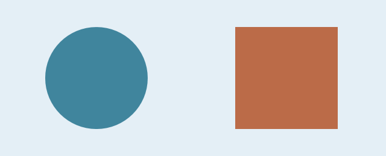

# 自然科学课本

## 第一课：观察形状

观察生活中的物体，认识**圆形**和**方形**，并尝试描述它们的*不同之处*。

> 先观察，再比较，最后记录。

- 圆形：轮廓弯曲，没有角。
- 方形：有直边，也有角。

| 图形 | 观察结果 |
| --- | --- |
| 圆形 | 没有角 |
| 方形 | 四个角 |



## 课堂练习

1. 找出教室里三个圆形物品。
2. 找出两个方形物品。
3. 用自己的话描述它们。

---

## 记录示例

使用行内代码记录分类：`shape = circle`。

```text
物品：钟面
形状：圆形
特点：没有角
```
